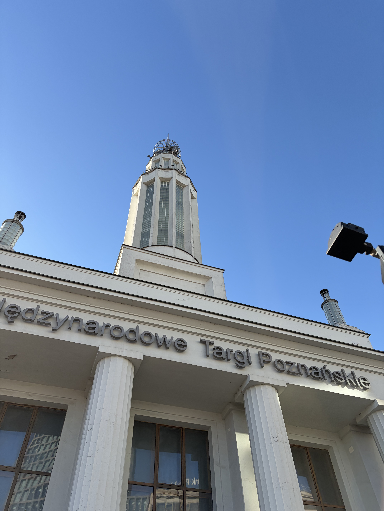
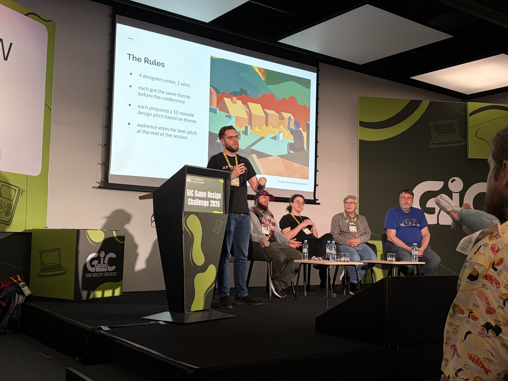
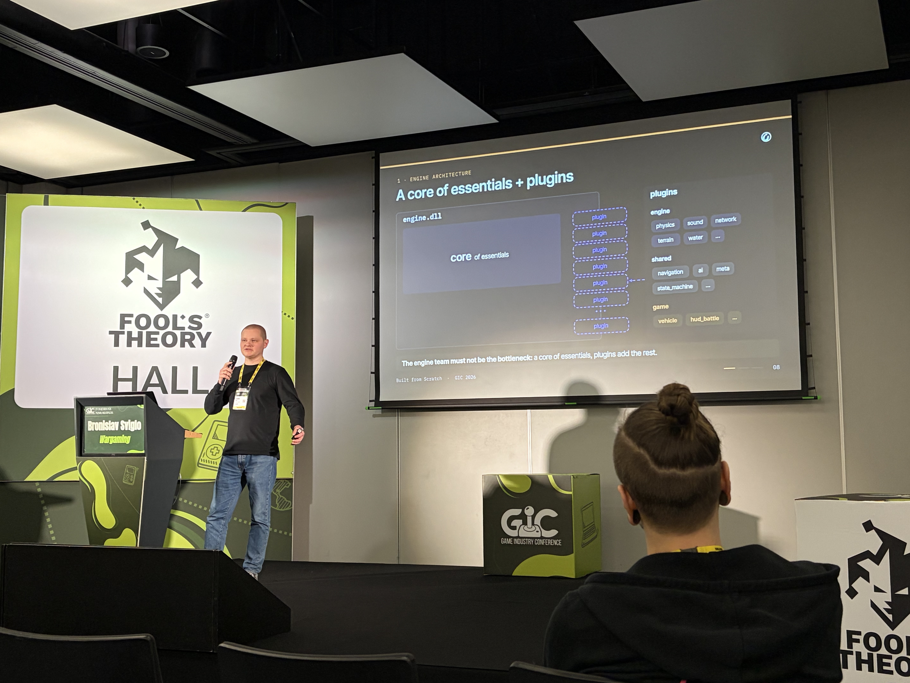
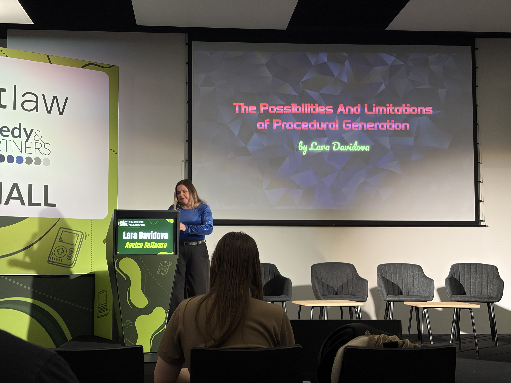
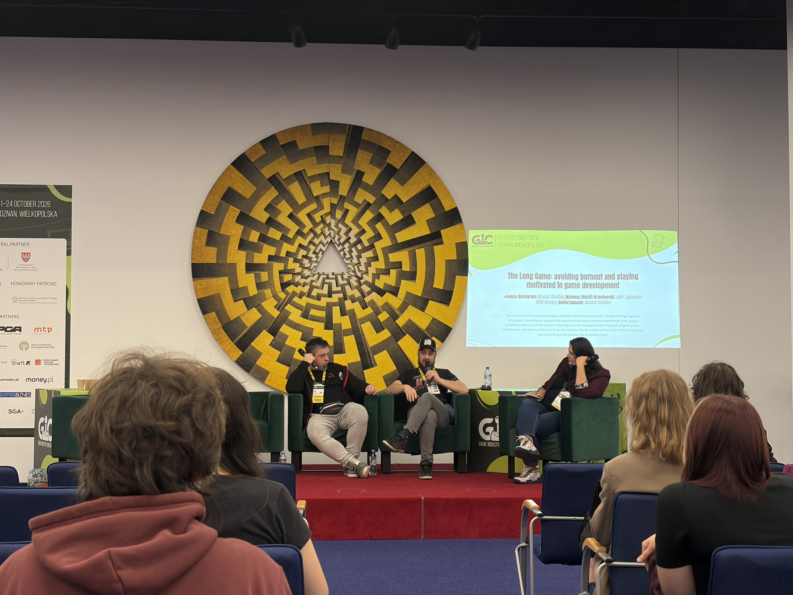
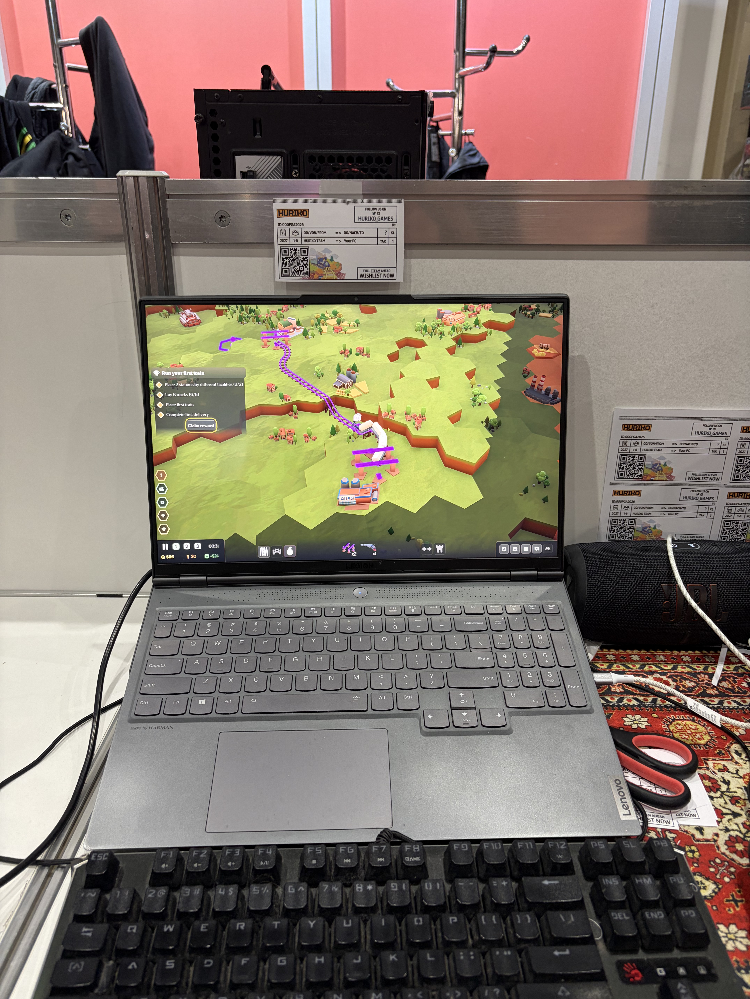
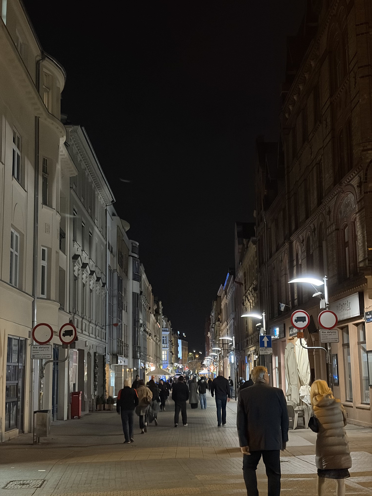
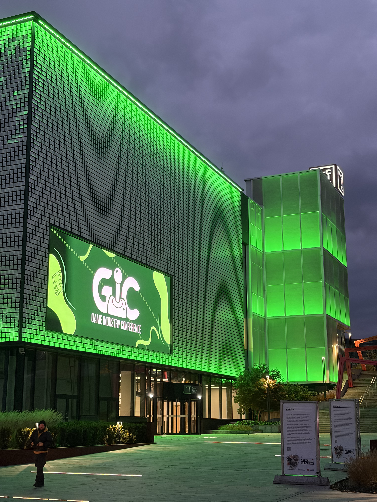

Having just returned from this year's Game Industry Conference, I wanted to share my experience there. Partly as a note for myself, but also for anyone wondering how it looks from the inside. As always, the time passed extremely quickly, filled with insightful talks, many coffee breaks and, most important of all, lots of great conversations with the folks from the industry.

It was my third time visiting the conference, and this time was different, since I wasn't going alone. I was joined by my manager who was accompanying me for the whole trip to Poznań. During the last year's Black Friday sale we managed to get two tickets for the price of one, so I only paid for half the price of the indie pass. We also shared the Airbnb, so the cost for accommodation was split.

Overall I do recommend looking out for the Black Friday sales on GiC website and socials. It's an insane value for money if you get it, especially comparing the ticket's price to other similar events. You also get PGA (Poznań Game Arena) pass for three days, which alone costs about as much as half an indie pass.

### First impressions

The first thing that stood out to me after I entered the conference building was that I almost instantly bumped into familiar folks. The first one was Jakub, who I first met two years ago at one of the parties. It was such a nice, welcoming feeling to recognize someone, and it turned into a common theme. Once in a while I randomly bumped into someone I happened to know from the previous events, said hello to them, and was introduced to someone I didn't yet know.

It all happened so naturally, so I never experienced any kind of pressure or stress of being forced to do “networking”. At earlier conferences I constantly had to reintroduce myself, as I didn't know anyone. This time I felt like I was among friends all the time, which was refreshing.

### Talks

Last year I was really eager to see all the talks that seemed interesting, and it somewhat didn't work out that well. I missed a lot of them, since I was staying in a room that was about an hour ride to the city center. So this time I knew I wanted to change my strategy.

There was definitely a lot of interesting talks every day. Once I'd imported them into the calendar I had each day basically filled, with a small lunch break. But this time I fully accepted that I needed to be okay with missing some of them. This was also reinforced on the very first talk I attended. The event was basically called “sigma-sized”, meaning it's impossible to see every talk, talk to everyone, and experience everything you want.

So with this kind of more loose approach in mind, I still managed to see most of the talks that I had in my calendar. About 75% of them, which I think is a good balance leaving some time for random meetings and exploring around. I won't go into much detail about every talk but just say which stood out the most for me, and why.

The first one was GiC Game Design Challenge 2026. It was a challenge previously held periodically at the Game Developers Conference, and after some years it was reintroduced here. The challenge was to create a game design based on a common theme, which was “a game that creates new jobs”.

First of all, participants were really interesting personalities: Bob Bates, a 37-year veteran of the game industry, Steven Meretzky, another veteran with 45 years of experience, Sos Sosowski, best known for McPixel, and Marta Fijak, who worked at Techland, 11 bit studios and Anshar Studios.

It was a great opportunity to see the thinking process of these great designers, and how different their approaches were from each other. The concepts they came up with were also really fun, like Creationeering from Steven Meretzky - a television talent show where each participant was responsible for the ideas, then cooperating with a powerful AI agent who executed the necessary work to make it come to life.

The next two talks I wanted to mention were a duo from Wargaming. “Built from Scratch: The Engine Behind World of Tanks: HEAT” by Bronislav Sviglo, and “60 FPS Everywhere: 'World of Tanks: HEAT' on Four Platforms” by Denis Ishmukhametov. Man, what a journey it was!

The first talk was a deconstruction and bird's eye overview of the custom made engine for World of Tanks: HEAT. But even if you are not a hardcore engine programmer (which I'm not, I'm a web developer after all) I think Bronislav still did a fantastic job of explaining the concepts behind the architecture, so that it was clear and insightful. I was impressed that ECS wasn't used only for the game objects, but also for other systems like UI, input and rendering.

The second talk by Denis was specifically about the strict platform requirements, tackling the topics like the min-max specifications, performance testing process, and dealing with upscalers. It was a nice addition to the engine talk, and was also presented in a very clear way. I don't personally play World of Tanks, but boy, it does have some cool tech behind it!

Next talk was from Lara Davidova, the developer of Vuntra City - VR procedurally generated city explorer. First of all, it was presented clearly and with great detail. The tips for procedural generation were given in a way that can apply to every project, not just generating buildings or rooms in a city.

I won't be going into much detail, but if you have a VR headset I do recommend checking out her game, which has a [free demo on Steam](https://store.steampowered.com/app/2859220/Vuntra_City/). Also, Lara was wearing a sparkly shirt, which was so charming, because it gave the impression that the sparks of light reflecting from it were also part of some random procedural generation - I bet it wasn't accidental.

---

I thought that was it, but then I remembered about one more talk related to VR. It was from my friend [Grzegorz Dąbrowski](https://gregs.works/), about optimization of VR (and non-VR) scenes using occluders.

Occluders are basically large structures that block the player's view so that the GPU has an easier time rendering the scene. The talk was also presented very clearly, with many examples, and the reasoning behind them. I think it was useful not only for Technical Artists, like Grzegorz, but also other specialties like Game Designers and Art people.

I really enjoyed getting to see the behind the scenes of how placing such occluders was  planned, and how they can also serve a gameplay purpose of directing the player attention towards a specific point. Quality stuff, and I'm looking forward to next talks from Grzegorz, which are always fun to attend.

### Poznań Game Arena

Alongside the conference, there was another big event happening - Poznań Game Arena. The event is definitely worth seeing if you already have the conference pass, especially during the media hours, as there aren't any queues yet.

I managed to see the demo of the Witcher 3: Songs of the Past DLC which was quite lengthy, about 45 minutes. It was a live presentation and managed to bring all the positive memories about this franchise, so I will check out the expansion pack when it comes out.

As a souls fan, I also checked out Valor Mortis during my visit at PGA. I wondered how the gameplay felt and it did indeed impress me. It does kind of feel similar to what Dying Light did with the stamina mechanic, but I unfortunately only managed to play for about 10 minutes. I'll probably wait for the price drop and play it some more.

The indie booths were also really cool and there were lots of good games. One especially caught my eye, as it looked like a project I was playtesting in a closed beta some time ago. And it turned out that it was the same project! 

Piotr, my co-worker from the past, was presenting his game at Indie Games Poland Foundation booth. The game is called Trains Together, and it's a cozy resource management game, where you build a network of trains delivering supplies to factories. I only managed to play it for a bit, and couldn't really focus on the game, but it looks so awesome thanks to the new assets, which weren't there the last time I played it. I recommend [adding it to your wishlist on Steam](https://store.steampowered.com/app/1526940/Trains_Together/), and look out for the updates there, as it has a planned release for 2027.

### The parties

It's pretty standard at these events to have some less formal ways to socialize after the conference time ends. My indie pass included an entry to only one of the three parties, which was on Friday. Alongside the official parties there were also some unofficial ones (this time listed on the main website, nice!).

After first day of talks was concluded we (me and my manager) went straight to the unofficial party at HOUSE Szkolna, which is one of those must see spots in Poznań if you're into creatively designed pubs. For us it was the only available option, since we only had indie passes. We stayed there for a while, but there didn't seem to be much happening. We managed to talk to some people wearing recognizable passes around the neck, but it was clear that pretty much everyone went straight to the official party.

To enter the official one it was required to have at least a business pass (one tier above indie). Since it was already past 9PM, I decided to give it a shot, thinking that at least one of these would probably be true:

- The security would *probably* not check every pass on every entry, since people are probably constantly coming out of the party and then coming back in
- If I still get my pass checked, I could probably ask someone who is leaving early to just switch passes with me, and use their pass to get in. Since people are so friendly here, someone would probably agree

So the plan was pretty much set up. The place was about a 10 minute walk from Szkolna street, so I went there and started looking around. I spotted some people standing outside, so it was looking promising.

I walked in, and my pass was checked instantly by the security guys, so the first option was out. When I got back outside, I talked to one nice guy (who I won't mention by name to not get him into trouble) who was kind enough to help me with getting in, and we also had a nice chat.

The official party was actually filled with people, which I hadn't expected. Overall it was a good experience, especially since I wasn't planning to get there at first, and it made a good story. After it ended, everyone went to the place we visited before, HOUSE. which was then packed with people.

The Friday party was also a good experience, this time called a SausageFest, which I believe is also some tradition from GDC. Since it was open for everyone, like indies and volunteers, it was a good way to make some new connections.

### Summary

Overall I was very satisfied with the time spent at the conference. Each day passed extremely quickly, which is always a sign of time well spent. There was always something interesting to do, like meeting new and interesting people, attending talks, workshops, and roundtables, or just looking around. Like on the previous conferences, it was impossible to experience everything, but I think each time it is becoming easier and easier to prioritize what I actually want to get out of this time.

Huge thanks to each and every one of you who I managed to talk to, you guys are awsome. It is  inspiring to see such supportive, open minded and generally great people working in the game industry. I hope to see you again next year :)